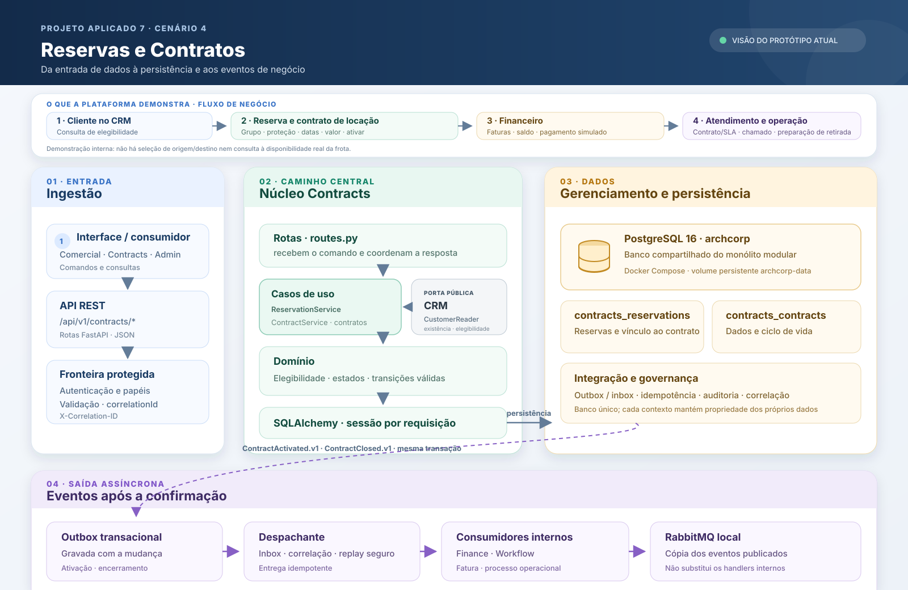

# Arquitetura do módulo de Reservas e Contratos

> Visão do fluxo implementado no protótipo. A aplicação é um monólito modular com dados sintéticos; não há conexão comprovada com sistemas reais da Localiza.

## Situação atual e próxima etapa

A figura usa três estados visuais:

- **Verde/contorno sólido:** recurso implementado no protótipo.
- **Azul e identificação “local”:** comportamento executado dentro da aplicação com dados sintéticos e adaptadores/simuladores.
- **Cinza claro/tracejado:** conexão ou capacidade planejada; ainda não implementada nem conectada a sistema corporativo.

O trabalho atual estabelece os contratos REST, os módulos e os fluxos locais. Depois dessa base, os adaptadores externos poderão ligar o protótipo aos sistemas reais — CRM, disponibilidade de frota e pontos de retirada/devolução, assinatura, cobrança, atendimento e BPM. A seta tracejada mostra o ponto planejado de entrada desses conectores pela camada de integração.

## O que a pessoa consegue fazer na demonstração

A interface é uma demonstração operacional por perfis, voltada às equipes que atendem o fluxo, não um portal público de autoatendimento para clientes. Ela permite:

- Consultar um cliente elegível no CRM e solicitar uma reserva de locação com grupo de veículo, proteção, datas, valor e ciclo de cobrança.
- Gerar o rascunho do contrato, ativar, cancelar a reserva ou encerrar o contrato.
- No Financeiro, consultar faturas e saldo, registrar pagamentos simulados e verificar vencimentos.
- No Atendimento, consultar se um contrato está ativo e qual SLA se aplica, abrir/acompanhar chamados e encaminhar a resolução para Workflow.
- No Workflow, acompanhar processos e tarefas, inclusive a preparação de retirada iniciada após a ativação.

**Limite do protótipo:** não há campos para origem e destino da viagem, busca de disponibilidade real de veículos, assinatura, cobrança ou pagamento real. O fluxo representa a integração entre CRM, Reservas e Contratos, Financeiro, Atendimento e Workflow.

## Fluxo ponta a ponta

```mermaid
flowchart LR
  classDef entrada fill:#E8F1FF,stroke:#3973C6,color:#12315A,stroke-width:1.5px
  classDef core fill:#E9F8F2,stroke:#16866A,color:#104D40,stroke-width:2px
  classDef dados fill:#FFF4DF,stroke:#D28B18,color:#62410C,stroke-width:1.5px
  classDef evento fill:#F3ECFF,stroke:#8056C8,color:#3D276B,stroke-width:1.5px
  classDef externo fill:#F4F6F8,stroke:#788694,color:#283542,stroke-width:1.5px

  subgraph IN["01 · Entrada e ingestão"]
    direction TB
    C["Interface / consumidor<br/>Comercial · Contracts · Admin"]:::entrada
    HTTP["API REST<br/>/api/v1/contracts/*"]:::entrada
    VAL["Autenticação e papéis<br/>validação · correlationId"]:::entrada
    C --> HTTP --> VAL
  end

  subgraph CORE["02 · Núcleo central · Contracts"]
    direction TB
    ROUTE["Rotas FastAPI<br/>routes.py"]:::core
    SVC["Casos de uso<br/>ReservationService · ContractService"]:::core
    DOM["Domínio<br/>regras de elegibilidade<br/>estados e transições"]:::core
    ORM["Persistência<br/>SQLAlchemy · sessão por requisição"]:::core
    ROUTE --> SVC --> DOM --> ORM
  end

  VAL --> ROUTE

  CRM["CRM · porta pública de leitura<br/>CustomerReader + retentativas limitadas<br/>valida existência e elegibilidade"]:::externo
  SVC -. consulta do cliente .-> CRM
  CRM -. dados do cliente .-> SVC

  subgraph DB["03 · Gerenciamento e armazenamento"]
    direction TB
    PG[("PostgreSQL 16 · banco archcorp<br/>volume persistente no Docker Compose")]:::dados
    T1["contracts_reservations"]:::dados
    T2["contracts_contracts"]:::dados
    TX["Tabelas compartilhadas de integração<br/>idempotência · auditoria · outbox / inbox"]:::dados
    PG --- T1
    PG --- T2
    PG --- TX
  end

  ORM -->|"grava / consulta"| PG

  subgraph EVT["04 · Eventos após mudança confirmada"]
    direction TB
    OUT["Outbox transacional<br/>ContractActivated.v1<br/>ContractClosed.v1"]:::evento
    DISP["Despachante de integração<br/>inbox · idempotência · correlação"]:::evento
    CONS["Consumidores internos<br/>Finance · Workflow"]:::evento
    MQ[("RabbitMQ local<br/>cópia dos eventos")]:::evento
    OUT --> DISP --> CONS
    DISP --> MQ
  end

  PG -->|"mesma transação de negócio"| OUT
  CONS -->|"fatura / processo operacional"| PG

  class C,HTTP,VAL entrada
  class ROUTE,SVC,DOM,ORM core
  class PG,T1,T2,TX dados
  class OUT,DISP,CONS,MQ evento
  class CRM externo
```

## Como ler

1. **Entrada:** comandos e consultas chegam pela API REST de contratos. A fronteira valida o corpo, aplica os papéis autorizados e propaga um `X-Correlation-ID`.
2. **Núcleo central:** as rotas chamam os serviços de reserva e contrato. As regras de negócio ficam no domínio; o SQLAlchemy persiste usando uma sessão por requisição.
3. **Consulta ao CRM:** Contracts usa a interface pública de leitura do CRM para verificar o cliente e sua elegibilidade. No protótipo, os módulos são montados no mesmo processo. A leitura resiliente repete falhas transitórias de forma limitada; se o CRM não responder, a API devolve `503` antes de gravar efeitos.
4. **Gerenciamento de dados:** reservas e contratos são propriedade de Contracts. Os registros ficam nas tabelas `contracts_reservations` e `contracts_contracts`; as tabelas de integração guardam preocupações transversais, como idempotência, auditoria e outbox/inbox.
5. **Saída:** ativação e encerramento gravam seus eventos na outbox na mesma transação da mudança de negócio. O despachante processa os consumidores internos (Finance e Workflow) e publica uma cópia no RabbitMQ local.

## Banco de dados e limites

- **Configuração do Docker Compose:** PostgreSQL 16, banco `archcorp`, persistido no volume `archcorp-data`.
- **Execução sem Compose:** a configuração padrão usa SQLite; `DATABASE_URL` permite selecionar o banco.
- **RabbitMQ:** recebe cópia dos eventos publicados; os consumidores internos são processados pelo despachante da aplicação.
- **Ambiente externo:** a execução em Render/Supabase não foi verificada. A configuração do protótipo não comprova integração com CRM, frota, assinatura ou sistemas reais da Localiza.

## Referências no código

- API e composição: [`src/archcorp/contracts/routes.py`](../src/archcorp/contracts/routes.py), [`src/archcorp/main.py`](../src/archcorp/main.py)
- Regras e casos de uso: [`src/archcorp/contracts/service.py`](../src/archcorp/contracts/service.py), [`src/archcorp/contracts/domain.py`](../src/archcorp/contracts/domain.py)
- Modelos e conexão: [`src/archcorp/contracts/models.py`](../src/archcorp/contracts/models.py), [`src/archcorp/infrastructure/db.py`](../src/archcorp/infrastructure/db.py)
- Outbox, despacho e broker: [`src/archcorp/integration/service.py`](../src/archcorp/integration/service.py), [`docker-compose.yml`](../docker-compose.yml)
- Estado verificado: [`docs/ESTADO_IMPLEMENTACAO.md`](ESTADO_IMPLEMENTACAO.md)
