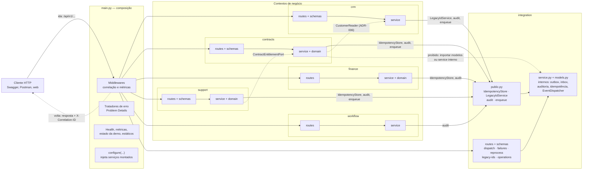
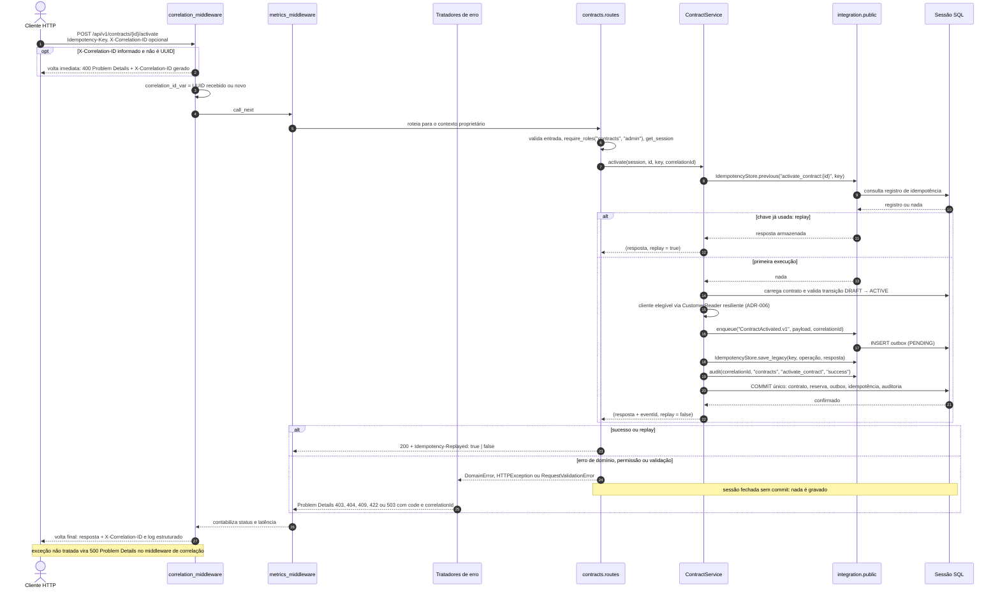
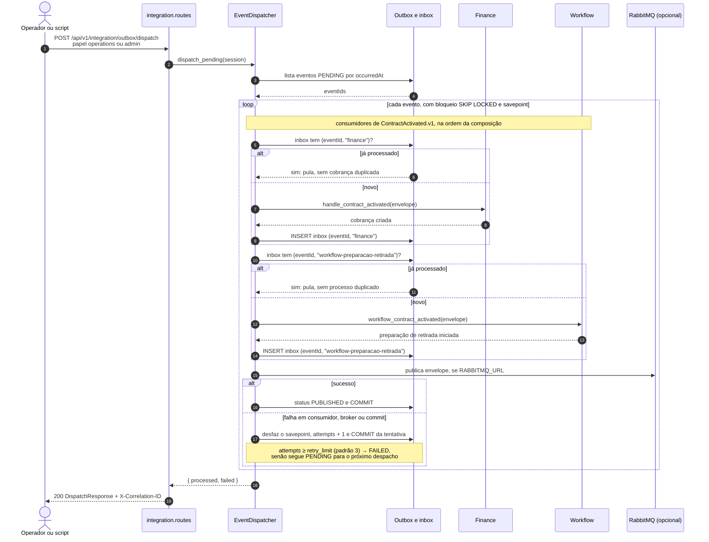
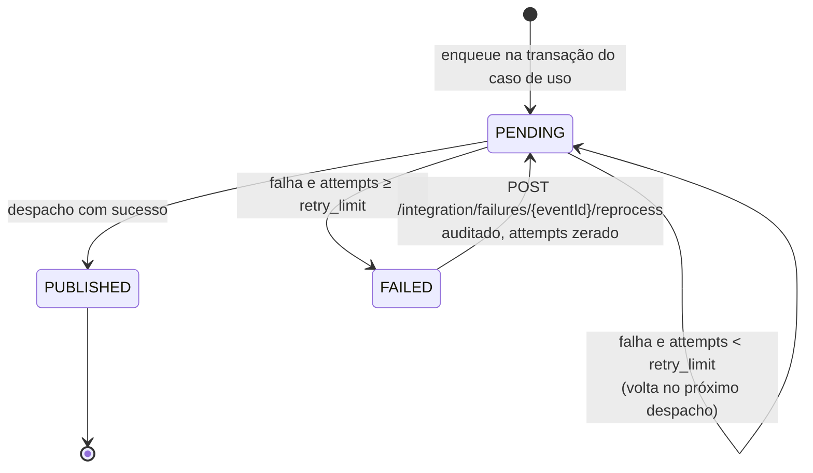

# ADR-005 — Rotas e schemas por módulo; fachada pública de integração

- Status: Aceito para execução do planejamento autorizado pelo responsável do projeto
- Data: 2026-10-15
- Relaciona-se com ADR-001, ADR-003 e ADR-004

A composição `main.py` acumulava rotas de Contracts, Support e Integration e
schemas sem proprietário. Módulos de negócio importavam IdempotencyRecord e
utilitários de integration.service, contrariando a fronteira pública prevista.

As rotas passam aos routers dos contextos correspondentes. `main.py` mantém
composição dos adaptadores/serviços, inicialização, middleware, health checks,
métricas, estado da demonstração e arquivos estáticos. A configuração explícita
dos serviços nos routers preserva o padrão existente; não introduz contêiner de
injeção nem novos serviços distribuídos.

Schemas de CRM, Contracts, Support e Integration ficam em cada contexto.
`archcorp.schemas` continua como fachada dos imports públicos anteriores, usando
as mesmas classes. Exemplos sintéticos e metadados de erro HTTP ficam separados
de estado e casos de uso em api_examples.py e api_docs.py.

A fachada `integration.public` expõe idempotência, auditoria, eventos e IDs
legados. Os negócios deixam de importar modelos e implementação internos de
Integration. Consultas/gravações legadas de idempotência ficam encapsuladas,
preservando fingerprints ausentes e replay anterior da ativação/encerramento.
A implementação transversal ainda usa SQLAlchemy e permanece em Integration;
não se declara arquitetura hexagonal completa nem implementação movida para
infrastructure. O domínio permanece independente de HTTP e persistência.

O PR29 antigo foi examinado e não foi integrado por causa da base desatualizada e
dos conflitos. A eliminação da consulta duplicada de idempotência foi reaplicada
com um método público proporcional. Não foram incorporadas mudanças gerais de
docstrings ou simplificações sem relação com a estabilização.

Verificação: comparação integral do OpenAPI antes/depois da extração, testes de
comportamento existentes, fronteiras por AST e imports legados por identidade.
Um baseline independente da main 5e344e2 protege operações, status, mídias,
parâmetros e propriedades existentes, além de campos obrigatórios de entrada e
garantias de resposta. Somente as duas diferenças de schema do ADR-003
(InvoiceResponse.status e PaymentInput.amount) têm exceções exatas no fixture.
Esse controle não substitui as caracterizações HTTP, migrações e F1–F3, nem
pretende provar compatibilidade de todo comportamento Python por análise estática.

## Diagramas

Os diagramas abaixo foram adicionados em 2026-10-19 para ilustrar a decisão já
aceita; não alteram o seu conteúdo. Eles descrevem o comportamento implementado
no protótipo (código em `src/archcorp`), com dados sintéticos. Setas cheias são
a ida; setas tracejadas são a volta (resposta ou retorno de chamada).

### Fronteiras após a extração

`main.py` só compõe e opera a aplicação. Cada contexto tem `routes.py` e
`schemas.py` próprios, e os módulos de negócio usam Integration apenas pela
fachada `integration.public`. A importação direta de modelos ou do serviço
interno de Integration por um módulo de negócio é proibida e verificada por
análise de AST nos testes. `archcorp.schemas` (fachada dos imports antigos),
`api_examples.py` e `api_docs.py` foram omitidos para legibilidade.

### Ida e volta de um comando HTTP (ativação do contrato)

Exemplo com `POST /api/v1/contracts/{id}/activate`. O comando atravessa os
middlewares e o router de Contracts; o caso de uso grava contrato, outbox,
idempotência e auditoria na mesma transação. Na volta, a resposta recebe
`Idempotency-Replayed` no router e `X-Correlation-ID` no middleware. Qualquer
erro volta pelo mesmo caminho, convertido em Problem Details, e a sessão é
fechada sem commit.

### Volta assíncrona: outbox, consumidores, retentativa e reprocessamento

O evento gravado na ativação só produz efeitos em Finance e Workflow quando o
despacho é acionado por `POST /api/v1/integration/outbox/dispatch`; não há laço
automático em segundo plano no protótipo. Cada evento roda em savepoint, cada
consumidor registra o `eventId` na inbox e a reentrega não duplica efeitos. A
cópia no RabbitMQ só é publicada quando `RABBITMQ_URL` está configurado.

O ciclo de vida do evento na outbox mostra as voltas possíveis. `FAILED` é um
status na tabela de outbox, não uma fila de erro no broker.

