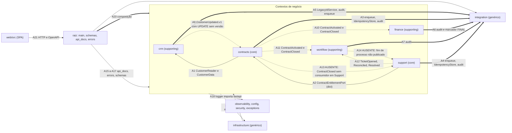

# Mapa de acoplamento — F-MOD (auditoria de 18/10/2026)

Referência: `main` = `44b8325`. Análise feita na cópia `iso-mod`, cuja integridade foi verificada contra `manifest_44b8325.sha256` (56 de 56 arquivos de `src/`, E-MOD-01). Execução em 2026-10-19 (UTC).

Fontes: grafo AST próprio (E-MOD-02), import-linter com configuração só em `scripts/` (E-MOD-03), volatilidade pelo git desde 2026-09-01 (E-MOD-13), inventário da raiz (E-MOD-17) e subdomínios como entrada documental (E-MOD-19).

## 1. Convenções

- **Força** (Khononov, *Balancing Coupling*): **baixa** = contrato (DTO, porta, payload de evento documentado); **alta** = funcional-transacional (mesma transação, outbox), conhecimento de modelo ou de handlers.
- **Distância**: **baixa** = mesmo contexto; **alta** = contextos distintos, raiz ou infraestrutura. Tratei os contextos como extraíveis (ADR-001), o que é premissa P2. A equipe é uma só, então não somei distância social.
- **Volatilidade do destino** (quem propaga a mudança): **alta** se o subdomínio é core ou se o módulo teve 7 ou mais commits desde 2026-09-01 (limiar declarado aqui). Caso contrário, **baixa**.
- **Equilíbrio** (`BALANCE = (FORÇA XOR DISTÂNCIA) OR NOT VOLATILIDADE`): forte + distante + volátil = **Crítico**; forte + distante + estável = **Aceitável**; fraca + distante = **Bom**; forte + próxima = **Bom** (coesão); fraca + próxima + volátil = **Atenção**. A fórmula não considera o custo de quebra; onde ela divergir do efeito real, o texto diz.
- **Parecer** (`modular-design-principles`, heurística de severidade): **P0** = risco de corrupção de dado, violação de fronteira de segurança ou persistência cruzada sem contrato; **P1** = dono pouco claro, API pública vazando, falha sem semântica na fronteira; **P2** = observabilidade, composabilidade e dívida que aumenta acoplamento.

## 2. Subdomínios e volatilidade (classificação de entrada, premissa a validar)

`docs/DDD_LOCALIZA.md` lista os contextos e suas fontes oficiais, mas não classifica core, supporting ou generic. A classificação abaixo é inferida do código e do documento (E-MOD-19).

| Módulo | Subdomínio inferido | Base | Commits desde 2026-09-01 (E-MOD-13) | Volatilidade |
|---|---|---|---|---|
| `contracts` | core | reserva, contrato, ciclo de vida e SLA (`contracts/domain.py`) | 8 | Alta |
| `support` | core | assistência 24h, prioridade e SLA (`support/domain.py`) | 7 | Alta |
| `workflow` | supporting | estado operacional de processos e tarefas | 7 | Alta (limiar) |
| `crm` | supporting | cadastro e elegibilidade | 7 | Alta (limiar) |
| `finance` | supporting | faturamento simulado, ciclos e inadimplência (`finance/domain.py`) | 6 | Baixa |
| `integration` | genérico | outbox, inbox, idempotência, auditoria, IDs legados (ADR-001 r.7 e r.11) | 5 | Baixa |
| `infrastructure`, `observability`, `security`, `config` | genérico | base ORM, log, auth e configuração | 6 (infraestrutura) | Baixa |
| raiz (`main.py` e compartilhados) | composição e genérico | `main.py` | 10 | Alta |
| `web/src` | interface | SPA que consome a API | 5 | Baixa |

Observação: `integration` é genérico, mas tem churn de 5 commits, o que sustenta a classificação de estável. Se Finance for core, a aresta A6 muda de equilíbrio e precisa ser reavaliada (ver Q3 em `resumo.md`).

## 3. Grafo de acoplamento

Setas contínuas: contrato ou transacional. Setas tracejadas com rótulo: evento. Setas tracejadas com "AUSENTE": fluxo que deveria existir e não existe. Os números A1 a A24 são as arestas da tabela da seção 4.

## 4. Tabela de arestas

| ID | Origem → destino | Mecanismo (evidência) | Força | Distância | Volatilidade (destino) | Equilíbrio | Parecer |
|---|---|---|---|---|---|---|---|
| A1 | `contracts` → `crm` | `CustomerReader` e `CustomerData` em `crm/public.py`; `Session` na assinatura (`crm/public.py:27`) | Baixa (contrato) | Alta | Alta | Bom | P2 (Session na porta, aceito pelo ADR-005) |
| A2 | `support` → `contracts` | `ContractEntitlementPort.entitlement` devolve `dict` (`contracts/public.py:15`) | Baixa (contrato fraco) | Alta | Alta (core) | Bom | P2 (dict sem tipo, MOD-10) |
| A3 | `contracts` → `integration` | `enqueue`, `IdempotencyStore`, `audit` na mesma transação (`contracts/service.py:12,77,101`) | Alta (funcional-transacional, por desenho do outbox) | Alta | Baixa | Aceitável | P1 pela fachada (devolve ORM, MOD-10) |
| A4 | `support` → `integration` | idem (`support/service.py:22`) | Alta | Alta | Baixa | Aceitável | P1 pela fachada (MOD-10) |
| A5 | `crm` → `integration` | `LegacyIdService`, `audit`, `enqueue` (`crm/service.py:10`) | Alta | Alta | Baixa | Aceitável | P1 pela fachada (MOD-10) |
| A6 | `finance` → `integration` | `audit`, `IdempotencyStore` e marcador `FINAL_BILLING_MARKER` (`finance/service.py:32,83-116`) | Alta; estado de Finance na tabela de Integration | Alta | Baixa | Aceitável (dívida do ADR-003 §4) | P2 (MOD-12) |
| A7 | `workflow` → `integration` | `audit` (`workflow/service.py:7`) | Alta (transacional, leve) | Alta | Baixa | Aceitável | — |
| A8 | contextos → `infrastructure.db` | `Base`, `Session`, `get_or_raise`, `count_rows` (`crm/service.py:9`, `finance/models.py:9`) | Alta (base ORM compartilhada, ADR-001 r.5) | Alta | Baixa | Aceitável | — |
| A9 | `crm` → `contracts` (evento) | `CustomerUpdated.v1` consumido por `apply_customer_update` (`contracts/service.py:165-169`; `main.py:61`) | Baixa (contrato de evento); efeito é escrita em projeção | Alta | Alta (core) | Bom pela fórmula | **P0** (MOD-08, projeção sem versão) |
| A10 | `contracts` → `finance` (evento) | `ContractActivated.v1` e `ContractClosed.v1` com payload montado por `to_dict` (`contracts/service.py:172-180`) | Baixa | Alta | Baixa | Bom | P2 (valores em float, AUD-20 e AUD-21, F-DAD) |
| A11 | `contracts` → `workflow` (evento) | handlers `handle_contract_activated` e `handle_contract_closed` (`workflow/service.py:40-42, 96-105`) | Baixa | Alta | Alta | Bom | P2 (prazo de 72 h pelo relógio, MOD-14) |
| A12 | `support` → `workflow` (evento) | `TicketOpened`, `TicketEntitlementReconciled`, `TicketResolved` (`workflow/service.py:45-88`); fallback de 24 h (`:58`) | Baixa, com acoplamento semântico de prazo | Alta | Alta | Bom | P2 (regra de prazo duplicada, MOD-07) |
| A13 | `contracts` → `support` (evento) | **AUSENTE**: nenhum consumidor de `ContractClosed.v1` em Support (`main.py:57` lista só Finance e Workflow) | — | — | — | **Lacuna** | **P1** (MOD-02, AUD-28) |
| A14 | `workflow` → `support` (evento) | **AUSENTE**: fim de processo não é publicado (`workflow/routes.py:131-149`) | — | — | — | **Lacuna** | **P1** (MOD-01, AUD-30) |
| A15 | raiz (`api_docs`) → `contracts.service` | constante `CRM_UNAVAILABLE_DETAIL` (`api_docs.py:2`) | Baixa | Alta | Alta | Bom pela fórmula, mas com direção indevida | P2 (MOD-09) |
| A16 | raiz (`schemas`, fachada) → schemas de todos os contextos | reexportação (`schemas.py:31-34`) | Baixa (DTO) | Alta | Alta | Bom | P2 (hub; ADR-005 mantém) |
| A17 | raiz (`errors`) → `schemas` → contextos (indireta) | `errors.py:20` | Baixa | Alta | Alta | Bom | P2 (MOD-09) |
| A18 | contextos de serviço → `observability` → `fastapi` (indireta) | `logger` (`observability.py:7`); cadeias em E-MOD-03 | Baixa | Alta (framework) | Baixa | Bom pela fórmula; contrato `servicos-sem-http` **quebrado** | P2 (MOD-09) |
| A19 | `infrastructure.migrate` → models de todos os contextos | `import_module` dinâmico (`migrate.py:24-37`) | Alta (conhece as classes ORM) | Alta | Alta (models de contracts e support) | **Crítico pela fórmula**, reclassificado para Atenção: a consequência fica restrita às migrações | P2 (MOD-10; invisível ao import-linter, visível ao grafo) |
| A20 | `main` → serviços, handlers e routers de todos os contextos | composição (`main.py:12-39`) | Alta (conhece handlers) | Alta (raiz) | Alta | Não aplicável (composição por desenho) | P2 (MOD-11: seis motivos de mudança) |
| A21 | `web/src` → API HTTP | `api.ts` com tipos manuais; contrato OpenAPI | Baixa (contrato HTTP) | Alta | Alta (contracts e support) | Bom | P2 (MOD-15) |
| A22 | regras de contexto → `config.settings` | `finance/service.py:167`; `support/service.py:94`; `integration/service.py:95-129` | Baixa (entrada oculta de configuração) | Alta | Baixa | Bom pela fórmula | P2 (MOD-11) |
| A23 | contextos → raiz compartilhada (`exceptions`, `observability`) | `exceptions.py` em todos os contextos | Baixa | Alta | Baixa | Bom | — |
| A24 | intra-contexto (routes → service → models e domain) | coesão | Alta | Baixa | — | Bom (coesão) | P1 só em `workflow`, onde a regra está na rota (MOD-05) |

Acoplamento por pacote (grafo AST, E-MOD-02): `raiz` Ca 7, Ce 7, I 0,50; `contracts` 3, 4, 0,57; `support` 2, 4, 0,67; `workflow` 2, 3, 0,60; `finance` 2, 3, 0,60; `crm` 3, 3, 0,50; `integration` 7, 2, 0,22; `infrastructure` 7, 7, 0,50 (Ca = aferente, Ce = eferente, I = Ce/(Ca+Ce)).

Leitura da tabela: pela fórmula, nenhuma aresta de negócio entre contextos cai em Crítico. As arestas de negócio são por contrato ou transacionais por desenho (outbox). Os desequilíbrios reais estão em três lugares: (a) fluxos que deveriam existir e não existem (A13 e A14); (b) raiz e infraestrutura dependendo de contextos ou de FastAPI (A15 a A19); (c) a projeção de Contracts, que escreve sem versão (A9). Quando a fórmula diz "bom" para A9, o risco é de dado, e não de acoplamento; por isso ele é P0.

## 5. Princípios de `modular-design-principles`

| Princípio | Estado | Evidência | Achado |
|---|---|---|---|
| 1. Fronteiras bem definidas | Parcial | `integration/public.py` devolve ORM; `Session` nas portas (aceito) | MOD-10 |
| 2. Composabilidade | Parcial | flags globais (`contract_adapter_available`); `main` compõe tudo | MOD-11 |
| 3. Independência | Parcial | `configure()` e `settings` lidas em regras | MOD-11 |
| 4. Escala individual | Não verificável nesta frente | limites são globais; não há quotas por módulo | — |
| 5. Comunicação explícita | Parcial | eventos montados como `dict`; contratos documentados mas não tipados no código | MOD-10, MOD-15 |
| 6. Substituibilidade | Parcial | `pika` usado direto no despachante, sem porta | MOD-05 |
| 7. Independência de implantação | Atendido por desenho | um processo, outbox | — |
| 8. Isolamento de estado | Parcial | marcador de Finance na tabela de Integration; projeção de Contracts sem versão | MOD-12, MOD-08 |
| 9. Observabilidade por módulo | Parcial | todos os logs saem com `module=archcorp` | MOD-17 |
| 10. Falha independente | Parcial | timeout do CRM (ADR-006) e do broker presentes; sem regra para identificador inexistente quando Contracts cai; encerramento não propagado | MOD-03, MOD-02 |

Sinais de conformidade (`modular-design-principles`, "Architecture compliance pass"): domínios puros (`contracts`, `finance` e `support`) sem framework nem persistência, confirmado pelo import-linter (E-MOD-03); nenhum acesso direto a tabela de outro contexto (E-MOD-15); escrita entre contextos só pelo outbox na mesma transação (E-MOD-07). Sinais negativos: superfície pública com tipos de persistência (A3 a A5); propagação de estado ausente (A13 e A14).

## 6. Parecer P0 / P1 / P2

- **P0 (1):** MOD-08 — projeção de Contracts sobrescrita sem versão, por evento antigo (A9; AUD-04). Severidade média no registro, porque o disparo exige entrega fora de ordem; a reprodução é da F-DAD.
- **P1 (5):** MOD-01 (A14; workflow sem máquina de estados e sem dono claro da transição); MOD-02 (A13; encerramento não propagado); MOD-03 (falha sem semântica na fronteira com Contracts); MOD-04 (testes de fronteira que não protegem o dono dos dados); MOD-10 (API pública vazando ORM nas fachadas de integração).
- **P2 (11):** MOD-05, MOD-06, MOD-07, MOD-09, MOD-11, MOD-12, MOD-13, MOD-14, MOD-15, MOD-16, MOD-17.
- **Informativos:** MOD-18 (teste da deleção), MOD-19 (complexidade).

Síntese: o acoplamento entre contextos de negócio está equilibrado pela fórmula e, em grande parte, por desenho (contrato e outbox). Os riscos reais são de propagação de estado (A13 e A14), de regra no lugar errado (workflow e fachadas), de dependências invertidas na raiz (A15 a A19) e de uma projeção sem versão (A9). Nenhum item recomenda decomposição em serviços: o `AGENTS.md` veta microsserviços sem ADR, e a evidência não pede isso.

## 7. Recomendações e necessidade de ADR

| Recomendação | Achado | Exige ADR? |
|---|---|---|
| Definir a regra de encerramento e fazer Support consumir `ContractClosed.v1` | MOD-02 | Sim, decisão registrada (P-22 do plano) |
| Máquina de estados de tarefa e de processo, com método de intenção | MOD-01, MOD-13 | Não (regra interna do contexto) |
| Promover a configuração de import-linter para o repositório (job de CI) | MOD-04 | Não, mas exige aprovação do coordenador (altera o repositório) |
| Versão no evento `CustomerUpdated.v1` (mudança aditiva) | MOD-08 | Não; atualizar AsyncAPI e teste |
| Porta `BrokerPublisher` com adaptador pika e adaptador de teste | MOD-05 | Não para o adaptador; sim para trocar de broker (ADR-001 r.6) |
| Remover dependências da raiz (`api_docs`, `errors`, `observability` → contextos e FastAPI) | MOD-09 | Não; remover o facade `schemas` exige ADR (ADR-005) |
| Fachadas que devolvem DTO, não ORM | MOD-10 | Não |
| Trocar `configure()` por injeção de dependência | MOD-11 | Sim (ADR-005 escolheu o padrão atual) |
| Tirar o marcador de Finance da tabela de Integration | MOD-12 | Sim (muda dono de tabela transversal; ADR-003 §4) |
| Agregado único Contrato + Reserva | MOD-13 | Sim (muda fronteira de agregado) |
| `Money` e `Period` como value objects | MOD-07, MOD-13 | Não se restrito ao contexto; sim se virar núcleo compartilhado |

Não há recomendação de extração para microsserviço, Kubernetes ou banco adicional.
