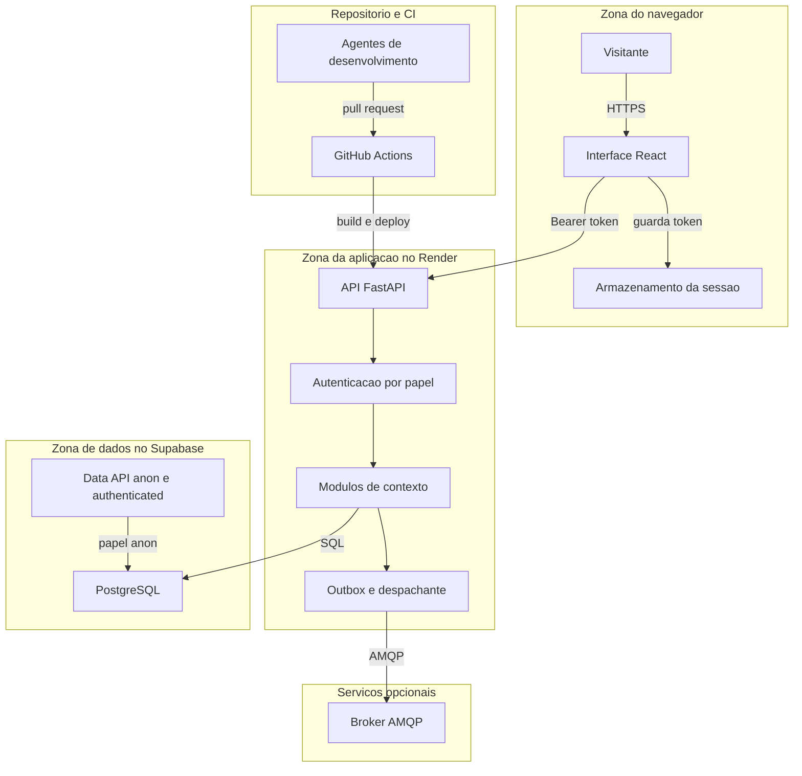

# Modelo de ameaças — ArchCorp (`44b8325`), F-SEG

## Check-in de premissas (antes do relatório final)

O briefing pede que a frente não pause. O check-in abaixo registra as premissas que mais mudam a priorização e as perguntas para o responsável. O modelo foi produzido com essas premissas explícitas.

- **Premissa 1:** o modo público (`PUBLIC_DEMO=true`) é o alvo de exposição, com dados sintéticos e uma credencial distribuída a visitantes (`web/src/App.tsx:146`, que pede a credencial ao responsável pelo projeto).
- **Premissa 2:** o serviço público roda no Render (plano gratuito) e o banco no Supabase (plano gratuito), como indica `render.yaml` e o plano de 01/10. Controles de borda (TLS, HSTS, limites de corpo) não foram vistos.
- **Premissa 3:** não existe autenticação OIDC; os papéis vêm de tokens fixos ou de uma credencial pública única, como `AGENTS.md` declara como meta e não como fato.
- **Premissa 4:** a interface (`web/`) é a única superfície HTML; não há outro front.
- **Premissa 5:** os resultados de PostgreSQL (RLS, privilégios de `anon`) não foram reexecutados; as afirmações dependentes de PostgreSQL têm confiança média.
- **Premissa 6:** o repositório é de uso acadêmico com dados sintéticos; dados reais inseridos por visitantes são um risco a ser considerado, não uma condição normal.

Perguntas para o responsável (não respondidas; o modelo segue com as premissas acima):
1. O modo público deve manter um único token com todos os papéis, ou haverá credenciais por papel ou só de leitura para visitantes (AUD-34 e P-15)?
2. Campos livres de chamado devem bloquear CPF, cartão, telefone, placa e e-mail na API, com a decisão registrada?
3. A regra "texto de fora é dado" (`archcorp-seguranca` §3) vai para a `main`, ou o branch `feat/skills-revisor` será mesclado?

---

## Executive summary

A superfície pública da demonstração é pequena: 53 operações de API, das quais 51 exigem papel, mais `/docs`, `/openapi.json`, `/metrics` (restrito), health e a interface estática. Os controles de autenticação e autorização funcionam como declarado: a matriz de 53 operações não encontrou divergência nos dois modos, nem resposta 5xx, e a travessia de caminho é bloqueada. Os riscos principais estão em três eixos. **Primeiro**, a credencial pública única dá papel de administrador sem limite de tentativas (SEG-01). **Segundo**, o controle de dado sensível em chamados existe, mas não é aplicado (SEG-02), o que combina com campos livres numa demo aberta. **Terceiro**, a proteção do PostgreSQL não cobre `alembic_version` nem sequências (Q-11, SEG-11), e o teste que deveria cobrir isso é um dublê (SEG-12). Não há ameaça crítica ou alta confirmada; as prioridades altas da modelagem decorrem de dados que visitantes podem inserir, não de falhas já exploradas.

---

## Scope and assumptions

**Em escopo (código e configuração que roda no serviço):**
- `src/archcorp/` (API, segurança, banco, observabilidade, erros, 6 contextos);
- `web/src/` e `web/dist` (interface);
- `render.yaml`, `Dockerfile`, `docker-compose.yml` (configuração de execução, somente leitura);
- `.github/workflows/verify.yml` (pipeline);
- `.claude/` e `skills-lock.json` (configuração de agentes), e a ausência de regras de texto externo.

**Fora de escopo nesta frente:** redação de documentação (`docs/`, `README.md`, ADRs como texto); Docker (proibido nesta auditoria); configuração do painel do Render e do Supabase (não vista); PostgreSQL e RabbitMQ reais (indisponíveis localmente; evidência de CI cobre o que a CI cobre).

**Premissas de contexto:** ver o check-in. Os riscos dependem de a demo ficar pública com a credencial distribuída; se o modo público for desligado, a superfície se reduz aos tokens locais (SEG-06).

**Perguntas abertas que mudariam a priorização:** as três do check-in. A primeira muda a severidade de TM-001 e TM-002; a segunda muda a de TM-004 (prioridade alta se a demo aceitar dado real); a terceira muda a de TM-011.

---

## System model

### Primary components

| Componente | Evidência (arquivo) | Papel no modelo |
|---|---|---|
| Interface React (SPA) | `web/src/App.tsx`, `web/src/api.ts`, `web/dist` (servido por `main.py:161-175`) | Coleta a credencial, guarda o token em `sessionStorage` (`App.tsx:31,34`), chama a API |
| API FastAPI (uvicorn) | `src/archcorp/main.py`, rotas por contexto | Entrada HTTP; autenticação por papel (`security.py`); validação por Pydantic |
| Autenticação e papéis | `src/archcorp/security.py:11-35` | Tokens fixos (local) ou credencial pública única (`PUBLIC_DEMO`) |
| Módulos de contexto | `crm`, `contracts`, `finance`, `support`, `workflow`, `integration` | Regras de negócio; escrevem no banco na mesma transação que a outbox |
| Outbox e despachante | `src/archcorp/integration/service.py` | Publica eventos internamente e, se configurado, no broker |
| Banco PostgreSQL (Supabase) e SQLite (local) | `src/archcorp/infrastructure/db.py`, migrações | Persistência; RLS e REVOKE para `anon` e `authenticated` nas tabelas do modelo |
| Broker AMQP (opcional) | `integration/service.py:109-145` (`pika`); `docker-compose.yml` | Cópia de eventos; não usado no Render (`RABBITMQ_URL` não definida em `render.yaml`) |
| Observabilidade | `src/archcorp/observability.py`; logs do uvicorn | Logs JSON por operação; métricas em `/metrics`; log de acesso com query string |
| Provedores | `render.yaml` (Render, plano gratuito); Supabase (Data API) | Execução do serviço e do banco; variáveis de ambiente fora do repositório |
| CI | `.github/workflows/verify.yml` | Testes, auditoria de dependências, build do frontend e da imagem |
| Agentes de desenvolvimento | `.claude/agents/`, `AGENTS.md`, `CLAUDE.md` | Leem issues, PRs e arquivos; podem alterar o repositório |

### Data flows and trust boundaries

- **Navegador → API (HTTPS no Render, não verificado localmente).** Dados: credencial (cabeçalho `Authorization: Bearer`), JSON de comandos e consultas, `Idempotency-Key`, `X-Correlation-ID`. Canal: HTTP/1.1 sobre TLS no edge. Garantias: validação de `X-Correlation-ID` (UUID, `main.py:86-97`); autenticação por papel em 51 de 53 operações (E-SEG-07/08); validação Pydantic; ausência de limite de corpo (SEG-03); ausência de cabeçalhos de segurança (SEG-07); sem CORS (E-SEG-09).
- **Navegador → `sessionStorage` (no próprio navegador).** Dados: token de administrador da demo. Garantia: nenhuma além da origem; qualquer script da origem lê o valor (SEG-07).
- **Navegador → assets estáticos.** Dados: bundle JavaScript e CSS. Garantia: caminho de arquivo restrito a `web/dist/assets` (E-SEG-11). Dependência externa: Google Fonts (`style.css:1`).
- **API → PostgreSQL (psycopg/SQLAlchemy).** Dados: todo o estado do domínio. Canal: TCP com credencial na `DATABASE_URL` (variável do provedor, `sync: false`). Garantias: consultas parametrizadas, sem SQL montado com entrada do usuário (E-SEG-26 para o bandit e inspeção de `text()` e `exec_driver_sql`); RLS e REVOKE para `anon` e `authenticated` **apenas nas tabelas do modelo** (`db.py:49-53`); `alembic_version` e sequências ficam de fora (SEG-11).
- **Data API do Supabase (papéis `anon` e `authenticated`) → PostgreSQL.** Dados: quaisquer relações do schema `public` que o papel alcance. Garantia: RLS sem políticas nas tabelas do modelo (acesso negado); lacuna em `alembic_version` e sequências (SEG-11, Q-11).
- **API → broker AMQP (opcional).** Dados: envelope de evento (identificadores, valores, correlação). Canal: AMQP com credencial na `RABBITMQ_URL`; sem TLS na configuração local. Garantias: timeouts de conexão, confirmação de entrega e fila com limite (`integration/service.py:115-127`); credencial padrão no compose local (SEG-17).
- **API → logs (stdout).** Dados: linha de acesso (método, caminho, **query string**) e JSON de aplicação. Garantia: o JSON não grava payload, descrição de chamado nem token (E-SEG-19); o log de acesso grava o e-mail de consultas (SEG-08).
- **Provedor (Render) → serviço.** Dados: variáveis de ambiente (`DATABASE_URL`, `DEMO_ACCESS_TOKEN`), `PUBLIC_DEMO=true` (`render.yaml:8`). Garantia: segredos fora do repositório (`sync: false`); a verificação do painel não foi feita.
- **CI (GitHub Actions) → repositório e artefatos.** Dados: código, `GITHUB_TOKEN` do job (permissões `contents: read`, `verify.yml:8-9`). Garantia: permissões mínimas; actions referenciadas por tag (`verify.yml:28,47,57`).
- **Texto externo (issues, PRs, comentários) → agentes de desenvolvimento.** Dados: instruções em linguagem natural. Garantia: nenhuma regra na `main` (SEG-13).

#### Diagram

---

## Assets and security objectives

| Ativo | Por que importa | Objetivo de segurança (C/I/A) |
|---|---|---|
| Credencial da demonstração (`DEMO_ACCESS_TOKEN` e tokens locais `demo-*`) | Concede papel de administrador (`security.py:32`) | C e I (sem vazamento; sem uso indevido) |
| Estado financeiro simulado (faturas, pagamentos, cancelamentos) | Integridade dos fluxos F1 a F3 e da demonstração | I e A |
| Dados de chamados (descrição livre) | Podem receber dado pessoal ou de pagamento de terceiros (SEG-02) | C |
| Dados cadastrais de clientes sintéticos (nome, e-mail, consentimento, ID legado) | Desenho de dado pessoal; privacidade mesmo em demo | C |
| Eventos, outbox e inbox | Integridade da integração entre contextos | I e A |
| Trilha de auditoria e logs (`correlationId`, operação, resultado) | Rastreabilidade de operações críticas (AGENTS, Segurança) | I |
| Disponibilidade do serviço (Render gratuito) e do banco (Supabase gratuito) | A demonstração depende deles | A |
| `DATABASE_URL` e demais segredos do provedor | Acesso total ao banco | C e I |
| Código, pipeline e artefato (GitHub Actions, imagem) | Cadeia de suprimento | I |
| Token na `sessionStorage` e bundle da interface | Veículo para roubo do token (SEG-07) | C (do token) |
| Métricas e logs de acesso | Contêm e-mail codificado em query (SEG-08) | C |

---

## Attacker model

Atacantes considerados:
- **A1: visitante anônimo da demo pública** (internet, sem credencial). É o ator principal pedido pelo briefing.
- **A2: visitante que recebeu a credencial pública** (a credencial é distribuída pela própria interface; ver `App.tsx:146`). Tem o papel de administrador.
- **A3: quem possui a chave `anon` do projeto Supabase e a URL do projeto** (hipotético: a chave não está no repositório, e a interface não usa a Data API).
- **A4: autor de issue, PR ou arquivo externo lido por um agente de desenvolvimento** (injeção de instrução).

### Capabilities

- A1 envia qualquer requisição a rotas públicas (health, `/docs`, `/openapi.json`, interface estática e o fallback da SPA), em volume, com corpos grandes, cabeçalhos malformados ou sem limite de tentativas (E-SEG-17, E-SEG-21). Lê a estrutura completa da API (E-SEG-21).
- A1 tenta adivinhar a credencial pública sem limite (E-SEG-21: 300 tentativas sem bloqueio). Não há ataque de senha por usuário, porque não há contas.
- A2 executa qualquer operação dos 51 endpoints protegidos (E-SEG-08), incluindo reprocessamento de falhas, pagamentos simulados, cancelamento de faturas, trilhas e métricas, e cria dados com texto livre (chamados) que são lidos depois por outros papéis.
- A3, se a chave anon existir e a URL for conhecida, pode executar `DELETE` em `alembic_version` pela Data API (condição de SEG-11; a execução em PostgreSQL não foi feita).
- A4 pode induzir um agente de desenvolvimento a seguir instruções embutidas em texto (ausência de regra; SEG-13). A capacidade real depende das permissões do agente, não verificadas.

### Non-capabilities

- Nenhum atacante externo lê o banco diretamente sem a chave anon: a `DATABASE_URL` é variável do provedor (`render.yaml`, `sync: false`).
- Não há XSS identificado: a interface não usa `innerHTML`, `dangerouslySetInnerHTML`, `eval`, `document.write` nem `window.open` (E-SEG-33). Ainda assim, a ausência de CSP tornaria um XSS futuro muito mais grave (TM-005).
- Não há CSRF relevante: a autenticação usa cabeçalho `Authorization`, não cookie, e não há CORS que permita leitura cruzada (E-SEG-09).
- Não há travessia de caminho nos estáticos nem no fallback (E-SEG-11).
- Não há injeção de SQL com entrada do usuário no código: as consultas usam ORM ou `text()` sem interpolação de entrada (E-SEG-26 e inspeção).
- A1 não obtém dado real: a demo usa dados sintéticos (premissa 6), e nenhum segredo real foi encontrado no repositório ou no histórico (E-SEG-28 e E-SEG-29).
- Nenhum atacante altera o código ou a configuração do provedor sem credencial do próprio provedor.

---

## Entry points and attack surfaces

| Superfície | Como é alcançada | Fronteira de confiança | Observações | Evidência |
|---|---|---|---|---|
| 51 operações protegidas em `/api/v1/*` (POST, PATCH, DELETE, GET) | HTTPS → API; `Authorization: Bearer` | navegador/cliente → API | Papel por rota (`require_roles`); sem autorização por objeto (SEG-09) | E-SEG-07, E-SEG-08 |
| `GET /health/live`, `GET /health/ready` | público | navegador → API | `/health/ready` informa o status do banco (`{"status":"UP","database":"UP"}`); sem versão | E-SEG-07 |
| `GET /metrics` | papel `operations` ou `admin` | navegador → API | Rótulo pelo template da rota; cardinalidade limitada (AUD-24 resolvido) | E-SEG-18, E-SEG-21 |
| `GET /api/v1/demo/state` | papel `admin` | navegador → API | Só contagens | E-SEG-07 |
| `/docs`, `/redoc`, `/openapi.json` | público (também no modo público) | navegador → API | Superfície descritiva (SEG-10) | E-SEG-21 |
| `/`, `/assets/*`, fallback da SPA | público | navegador → API | Caminhos restritos (E-SEG-11); sem cabeçalhos (SEG-07) | E-SEG-09, E-SEG-11 |
| Cabeçalho `Authorization` | todas as rotas protegidas | navegador → API | Não ASCII → 500 no modo público (SEG-05) | E-SEG-21 |
| Cabeçalho `X-Correlation-ID` | todas | navegador → API | UUID obrigatório; inválido → 400 `problem+json` | E-SEG-12 |
| Cabeçalho `Idempotency-Key` | comandos | navegador → API | Máximo de 100; chave não escopada por principal (AUD-39, F-DAD) | E-SEG-14 |
| Query `email`, `customerId`, `contractId`, `serviceCode`, `legacyId`, `limit`, `offset` | `GET` | navegador → API | `email` vai ao log de acesso (SEG-08); `offset` sem teto (SEG-04 para integração) | E-SEG-19 |
| Corpo JSON (rotas POST e PATCH) | `POST`, `PATCH` | navegador → API | Sem limite de tamanho (SEG-03); leitura antes da autenticação; 422 expõe nomes de campos | E-SEG-17 |
| Campo livre de chamado (`description`) | `POST /api/v1/support/tickets` | navegador → API → banco | Aceita CPF, cartão, telefone, placa, e-mail (SEG-02) | E-SEG-16 |
| `sessionStorage` do navegador | JavaScript da origem | navegador | Token de administrador em texto (SEG-07) | E-SEG-33 |
| Data API do Supabase (`anon`, `authenticated`) | HTTP com chave anon e URL do projeto | externo → banco | Lacuna em `alembic_version` e sequências (SEG-11) | E-SEG-22, E-SEG-23 |
| Broker AMQP (opcional) | API → broker | serviço → broker | Credenciais padrão no compose local; sem TLS na configuração local (SEG-17) | E-SEG-29, E-SEG-32 |
| Pipeline (GitHub Actions, push e PR) | eventos do repositório | repositório → CI | `contents: read`; actions por tag (E-SEG-32) | E-SEG-32 |
| Texto de issues, PRs e arquivos externos | leitura por agentes | externo → agente | Sem regra de tratamento na `main` (SEG-13) | E-SEG-30 |

---

## Top abuse paths

1. **Uso de credencial pública para alterar a demonstração (A2).** O visitante recebe o token na tela de acesso → chama `POST /api/v1/integration/failures/{id}/reprocess` e `POST /api/v1/finance/invoices/{id}/cancel` → altera o estado da demo para todos os outros visitantes. Impacto: integridade do ambiente de avaliação (TM-001).
2. **Força bruta sem limite sobre a credencial pública (A1).** O atacante envia tentativas em `/api/v1/demo/state` (ou qualquer rota protegida) → 401 repetido, sem bloqueio nem 429 (E-SEG-21) → se a credencial tiver baixa entropia, obtém papel de administrador (TM-002).
3. **Coleta de dado pessoal por campo livre (A1 ou visitante comum).** O visitante cola CPF, cartão e telefone na descrição de um chamado → 201 e gravação em texto puro (E-SEG-16) → qualquer papel de atendimento lê a descrição depois (TM-004).
4. **Negação de serviço com corpo grande e cabeçalho malformado (A1).** O atacante envia corpos de dezenas de MB sem token (lidos antes da autenticação, E-SEG-17) e cabeçalhos com bytes não ASCII (500, E-SEG-21) em paralelo → memória e CPU do plano gratuito esgotados → serviço lento ou fora do ar (TM-003).
5. **Derrubada do serviço pela Data API (A3, condicional).** Quem possui a chave anon executa `DELETE FROM alembic_version` pela Data API → a próxima inicialização falha (`DuplicateTable`, E3-14 do 01/10) → a demo fica fora do ar até restauração manual (TM-006).
6. **XSS hipotético com roubo do token de administrador (A1 com um XSS futuro).** Um script injetado lê `sessionStorage` (`App.tsx:31`) → envia o token ao atacante → administrador remoto. Sem CSP, não há barreira adicional (TM-005).
7. **Implantação sem `PUBLIC_DEMO` (operador descuidado).** O serviço sobe em modo local por padrão (`config.py:21`) → `demo-admin` aceito por qualquer requisição (E-SEG-07) → administração total com tokens publicados no código e no README (TM-007).
8. **Injeção por issue contra agente de desenvolvimento (A4).** Uma issue ou PR contém instruções para o agente → o agente, sem regra de texto externo na `main`, executa a instrução com as permissões que tem → alteração indevida do repositório (TM-011).
9. **Coleta de e-mails pelo log de acesso (quem lê logs).** Consultas a `GET /api/v1/crm/customers?email=` ficam no log de acesso codificadas (E-SEG-19) → quem tem acesso aos logs do provedor lê os e-mails (TM-008).
10. **Mapeamento da API para ataques dirigidos (A1).** O atacante lê `/openapi.json` (200 no modo público, E-SEG-21) e usa os exemplos e os nomes de campos (inclusive os `loc` dos 422 sem autenticação, E-SEG-17) para montar requisições válidas com menos tentativas (TM-009).

---

## Threat model table

| Threat ID | Threat source | Prerequisites | Threat action | Impact | Impacted assets | Existing controls (evidence) | Gaps | Recommended mitigations | Detection ideas | Likelihood | Impact severity | Priority |
|---|---|---|---|---|---|---|---|---|---|---|---|---|
| TM-001 | A2: visitante com a credencial pública | Token recebido na tela de acesso (`App.tsx:146`) | Executar operações administrativas (reprocesso, pagamento simulado, cancelamento, trilhas) | Alteração do estado da demonstração; leitura de trilhas | Estado financeiro; integração; auditoria | Token comparado em tempo constante (`security.py:30`); 401 sem token; `/metrics` restrito (`main.py:137`); E-SEG-08 | Credencial de papel único; sem ADR; sem auditoria por principal (SEG-01) | Credenciais por papel ou leitura; ADR; registro de ações por principal `public-demo` | Alerta por volume de comandos `POST`/`PATCH`/`DELETE` do principal público | Alta | Média | Média |
| TM-002 | A1: anônimo | URL pública | Adivinhar a credencial pública por tentativas repetidas | Obtenção de papel de administrador | Credencial; estado da demo | Token ≥24 caracteres e prefixo (`main.py:69-70`); comparação em tempo constante (`security.py:30`) | Sem limite de tentativas (300 → 300×401, E-SEG-21); sem exigência de entropia (SEG-01) | Limite por origem com 429; entropia ≥32 bytes na inicialização | Contagem de 401 por origem e por rota | Baixa | Alta | Média |
| TM-003 | A1: anônimo | URL pública | Corpos grandes, JSON inválido e cabeçalhos malformados em volume | Lentidão ou indisponibilidade; 500 em cabeçalho não ASCII | Disponibilidade; processo do serviço | Validação do schema (422); tratamento global de exceção (`main.py:100-104`) | Sem limite de corpo; corpo lido antes da autenticação; listagem de falhas sem teto; 500 para não ASCII (SEG-03, SEG-04, SEG-05) | Limite de corpo no edge e na app (413); autenticar antes do corpo; teto de listagem; `compare_digest` em bytes | p95 de latência; contagem de 413 e 500 por minuto; memória do processo | Média | Média | Média |
| TM-004 | Visitante comum, ou A1 que coleta dados | Credencial pública (ou papel de atendimento); campo livre de chamado | Gravar CPF, cartão, telefone, placa e e-mail na descrição; leitura posterior por outros papéis | Exposição de dado pessoal e de pagamento de terceiros; obrigação de tratamento | Dados de chamados; privacidade | Descrição limitada a 2.000 caracteres (`support/schemas.py:29`); heurística `contains_sensitive_data` (`domain.py:119-130`) não aplicada (E-SEG-15) | Sem validação no fluxo; falso negativo com parênteses; descrição devolvida a `operations` (SEG-02, SEG-09) | Validação no schema ou no serviço, com 422 sem eco; ajuste da heurística; aviso na interface; minimização da descrição nas listagens | Varredura periódica do banco por padrões de dado sensível; teste de API no CI | Média | Alta | Alta |
| TM-005 | A1 com um XSS futuro; ou um script de terceiro | Vulnerabilidade de renderização (nenhuma identificada) | Ler `sessionStorage` e usar o token de administrador; clickjacking da tela de acesso | Administração remota da demo; indução a digitar a credencial | Credencial; token na sessão | React escapa por padrão; nenhum `innerHTML`, `eval` ou `dangerouslySetInnerHTML` (E-SEG-33) | Sem CSP, sem `frame-ancestors`, sem `Referrer-Policy`; token em `sessionStorage` (SEG-07); Google Fonts | CSP restritiva; `frame-ancestors 'none'`; token em memória; fontes próprias; CSP em modo report-only antes de enforce | Relatórios de violação de CSP (depois de implantada) | Baixa | Alta | Média |
| TM-006 | A3: quem tem a chave anon do Supabase | Chave anon e URL do projeto (não estão no repositório) | `DELETE` em `alembic_version` pela Data API; leitura de relações sem RLS | Demo fora do ar até restauração manual; eventual leitura de metadados | Disponibilidade; banco | RLS e REVOKE em tabelas do modelo (`db.py:49-53`); teste dublê (E-SEG-24) | `alembic_version` e sequências fora da proteção (SEG-11); teste sem PostgreSQL real (SEG-12) | Incluir `alembic_version` e sequências no REVOKE/RLS; schema não exposto; teste em PostgreSQL com papéis reais | Alerta de falha de inicialização no Render; auditoria de uso da Data API | Baixa | Alta | Média |
| TM-007 | Operador descuidado; ou A1 que conhece os tokens publicados | Implantação sem `PUBLIC_DEMO` | Usar `demo-admin` e os demais tokens locais | Administração total do serviço | Todos os ativos | `render.yaml:8` define `PUBLIC_DEMO: "true"`; compose em `127.0.0.1` (E-SEG-32) | Padrão do código é o modo local (`config.py:21`); compose sem o modo (SEG-06) | Modo explícito; recusa de tokens locais sem modo; teste de inicialização | Log de inicialização com o modo; alerta se `demo-*` autentica fora de ambiente local | Baixa | Alta | Média |
| TM-008 | Operador ou agregador de logs | Acesso aos logs do provedor | Ler e-mails de consultas no log de acesso | Exposição de dado pessoal (sintético na demo) | Privacidade; logs | Log JSON sem payload, descrição nem token (E-SEG-19) | Log de acesso do uvicorn grava query string com e-mail (SEG-08) | `--no-access-log` ou filtro; busca por POST | Busca por `@` e `%40` nos logs (zero esperado) | Média | Baixa | Baixa |
| TM-009 | A1: anônimo | Nenhuma | Mapear a API por `/openapi.json` e pelos 422 | Facilita TM-001 a TM-003 | Superfície | 422 sem eco do valor enviado (E-SEG-13); nenhum segredo no esquema | `/docs` e `/openapi.json` públicos no modo público (SEG-10); 422 sem autenticação revela `loc` (SEG-03) | Desabilitar docs no modo público; 422 de campos só após autenticação | Contagem de acessos a `/openapi.json` | Alta | Baixa | Baixa |
| TM-010 | Usuário com papel de contexto (ou a credencial pública) | Papel `support` ou `operations` | Listar cadastro de clientes (e-mail, consentimento) ou ler descrições de chamados em volume | Exposição de dados além do necessário para o papel | Dados cadastrais; dados de chamados | Matriz por papel testada (E-SEG-07) | Sem autorização por objeto; sem response shaping (SEG-09) | ADR de visibilidade por papel; response shaping; teto de paginação | Contagem de leituras em massa por principal | Média | Baixa | Baixa |
| TM-011 | A4: autor de issue, PR ou arquivo externo | Agente de desenvolvimento com permissão de escrita lê o texto | Instruções embutidas que o agente executa (alterar código, criar PR, revelar contexto) | Alteração indevida do repositório; vazamento de contexto do agente | Código; pipeline; contexto de agentes | Regra `archcorp-seguranca` §3 existe apenas em `feat/skills-revisor` (E-SEG-30) | Regra ausente na `main` (SEG-13) | Incorporar a regra em `AGENTS.md`/`CLAUDE.md` na main; revisão humana de PRs de agentes; permissões mínimas | Revisão de diffs gerados por agentes; alerta de alterações fora de escopo | Média | Alta | Média |
| TM-012 | Leitor do repositório | Acesso ao repositório (visibilidade não verificada) | Reutilizar as credenciais de desenvolvimento em ambiente real | Baixo: credenciais locais e sintéticas | Serviços locais | Senhas de CI e de compose com valor sintético (`<REDACTED>`); nenhum segredo real no histórico (E-SEG-29) | Credenciais padrão em `docker-compose.yml` e `verify.yml`; literais de teste (SEG-17) | Ler do ambiente no compose; manter nomes sintéticos; detector de segredos no CI (F-CFG) | Varredura de segredos no CI (ausente) | Baixa | Baixa | Baixa |
| TM-013 | Operador ou atacante na rede do broker | Broker exposto ou credencial padrão conhecida (compose local) | Consumir ou publicar eventos; ler payloads com identificadores e valores | Vazamento ou injeção de eventos de integração | Eventos; integração | Broker opcional e fora do Render; portas do compose em `127.0.0.1`; limites de conexão (`integration/service.py:115-127`) | Credencial padrão; sem TLS na configuração local (SEG-17) | Credenciais fora do compose; TLS e ACL em ambiente que use o broker | Monitor de conexões e de publicações não esperadas | Baixa | Média | Baixa |
| TM-014 | Atacante com ação de terceiros no CI ou dependência | Action referenciada por tag; dependência com advisory | Executar código no CI; explorar dependência de desenvolvimento | Alteração do artefato; roubo de token do job (limitado por `contents: read`) | Pipeline; artefato | Permissões mínimas (`verify.yml:8-9`); `npm ci` com lockfile; `pip-audit` no runtime (E-SEG-25) | Actions por tag (`verify.yml:28,47,57`); sem SAST e sem varredura de segredos na CI (F-CFG); pytest 8.4.1 (SEG-16) | Pin por SHA; SAST e varredura de segredos no CI; atualizar pytest | Dependabot/alertas; logs de CI | Baixa | Alta | Média |

---

## Criticality calibration

Calibração para esta demonstração: dados sintéticos, serviço público gratuito, credencial distribuída a visitantes. Os níveis mudariam se dados reais entrassem no sistema.

- **Crítico:** comprometimento de dados pessoais reais ou de pagamento de terceiros; execução de código no servidor por entrada anônima; indisponibilidade prolongada sem recuperação simples. *Exemplos neste repositório:* execução de SQL arbitrário pela Data API com gravação nas tabelas do modelo (hoje bloqueada); leitura em massa de chamados reais; injeção de código por campo de entrada (não identificada).
- **Alto:** acesso administrativo com dados de terceiros possíveis; XSS que rouba a credencial de administrador; indisponibilidade da demo por anônimo que exige intervenção manual. *Exemplos:* chamado com CPF real gravado e lido por atendimento (TM-004, se houver dado real); XSS futuro com token em `sessionStorage` (TM-005); `DELETE` em `alembic_version` pela Data API (TM-006, condicionado à chave anon).
- **Médio:** alteração do estado da demonstração com a credencial pública; negação de serviço parcial por anônimo; padrão inseguro que só se materializa com erro de implantação; injeção de instrução sem exploração demonstrada. *Exemplos:* reprocesso e cancelamento por visitante (TM-001); corpo de 20 MB anônimo (TM-003); implantação sem `PUBLIC_DEMO` (TM-007).
- **Baixo:** exposição de metadados técnicos; e-mail sintético em log de acesso; leitura de dados de papel de contexto sem dado real; credenciais locais conhecidas. *Exemplos:* `/openapi.json` público (TM-009); e-mail sintético em query de log (TM-008); 500 com cabeçalho malformado sem bypass (SEG-05).

---

## Focus paths for security review

| Path | Why it matters | Related Threat IDs |
|---|---|---|
| `src/archcorp/security.py` | Autenticação, comparação de token, papéis e o ramo público | TM-001, TM-002, TM-007 |
| `src/archcorp/main.py` | Guardas de inicialização, middlewares, documentação, tratamento de 500, fallback da SPA | TM-001, TM-003, TM-009 |
| `src/archcorp/config.py` | Padrão de `public_demo` (fail-open) | TM-007 |
| `src/archcorp/support/service.py`, `domain.py`, `schemas.py`, `routes.py` | Gravação e leitura de descrição de chamado; heurística sem uso | TM-004, TM-010 |
| `src/archcorp/errors.py` | Handlers de erro; 405 fora de `problem+json` | TM-003, TM-009 |
| `src/archcorp/infrastructure/db.py` | Proteção do banco público (laço sobre `sorted_tables`) | TM-006 |
| `src/archcorp/observability.py` | Logs JSON e rótulos de métrica | TM-008 |
| `src/archcorp/integration/routes.py` | Listagem de falhas sem teto; reprocessamento | TM-001, TM-003 |
| `src/archcorp/crm/routes.py` | Busca por e-mail na query; leitura de cadastro por papel | TM-008, TM-010 |
| `src/archcorp/contracts/schemas.py`, `contracts/routes.py` | Limites monetários e de tamanho ausentes no schema | TM-003 (SEG-15) |
| `web/src/App.tsx` | Token em `sessionStorage`; tela de acesso | TM-001, TM-005 |
| `web/src/style.css` | Fonte externa via `@import` | TM-005 |
| `render.yaml`, `Dockerfile`, `docker-compose.yml` | Modo público, comando de execução sem `--no-access-log`, portas e credenciais locais | TM-007, TM-008, TM-013 |
| `.github/workflows/verify.yml` | Permissões, actions por tag, ausência de SAST e de varredura de segredos | TM-012, TM-014 |
| `tests/test_public_database_security.py` | Teste de RLS com dublê | TM-006 |
| `requirements-dev.txt` | `pytest==8.4.1` com advisory (dev) | TM-014 |
| `AGENTS.md`, `CLAUDE.md`, `.claude/agents/` | Ausência de regra de texto externo | TM-011 |

---

## Notes on use

- Os registros de evidência estão em `evidencias.md` (E-SEG-01 a E-SEG-37) e os achados em `achados.md` (SEG-01 a SEG-17). Cada ameaça aponta para os IDs correspondentes.
- Os controles marcados como "existentes" foram verificados por execução ou por leitura de código, com a referência indicada.
- As afirmações que dependem de PostgreSQL, de Supabase real, de TLS no edge ou do painel do provedor têm confiança média ou não são verificáveis nesta execução.
- Este modelo não substitui o teste de penetração; ele prioriza o que deve ser testado e corrigido.

## Quality check

- [x] Todas as superfícies de entrada descobertas estão na tabela (53 operações, documentação, estáticos, cabeçalhos, query, corpo, `sessionStorage`, Data API, broker, pipeline e texto externo).
- [x] Cada fronteira de confiança aparece pelo menos numa ameaça: navegador → API (TM-001 a TM-005, TM-009); API → banco (TM-006); Data API → banco (TM-006); API → broker (TM-013); API → logs (TM-008); provedor (TM-007); CI (TM-014); texto externo → agente (TM-011).
- [x] Separação entre runtime, CI e dev: CI e dependências de desenvolvimento aparecem em TM-012 e TM-014; o runtime nas demais.
- [x] Entradas separadas por controle: atacante externo (A1, A3, A4), credencial distribuída (A2), operador (TM-007, TM-008) e entradas de desenvolvedor (TM-011).
- [x] Premissas e perguntas explícitas no check-in; as perguntas não foram respondidas e o modelo prossegue com as premissas.
- [x] Mermaid com `flowchart TD`, apenas `-->`, IDs simples e rótulos entre aspas nos nós.
